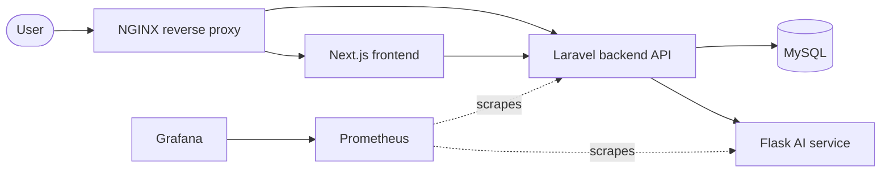

# Thumbworx Capstone: Smart Logistics Cloud Infrastructure

[](https://github.com/hiro-zeroth/thumbworx-capstone/actions/workflows/ci.yml)

Week 12 capstone for the Thumbworx Cloud Computing & DevOps training program. The goal was to containerize the Thumbworx smart logistics platform, run it on Kubernetes, define supporting AWS infrastructure with Terraform, automate builds with GitHub Actions, and monitor it with Prometheus and Grafana.

> **Backend acknowledgement:** The Laravel backend used in this capstone is based on the Thumbworx project starter/shared repository provided through the official Thumbworx development channels. My work focused on the cloud infrastructure, containerization, Kubernetes deployment, Terraform infrastructure, CI/CD pipeline, monitoring, and integration of the application components.

## What this project covers

- **Containerization:** one Docker image per service (frontend, backend, AI service).
- **Orchestration:** every component runs as its own Kubernetes Deployment and Service on Minikube, with NGINX as the reverse proxy.
- **Infrastructure as Code:** Terraform configuration for the supporting AWS resources (VPC, EC2, security groups).
- **CI:** a GitHub Actions workflow that builds the service images on every push.
- **Observability:** Prometheus collects metrics and Grafana visualizes them.

## Architecture



All services run as pods in a Minikube cluster. MySQL runs in-cluster rather than on a managed service such as AWS RDS, which kept the setup simple for the time frame of the capstone.

## Tech stack

| Layer | Technology |
|---|---|
| Frontend | Next.js (React, TypeScript) |
| Backend | Laravel 12 (PHP) with Sanctum |
| AI service | Python, Flask |
| Database | MySQL 8 |
| Containers | Docker |
| Orchestration | Kubernetes (Minikube) |
| Reverse proxy | NGINX |
| Infrastructure as Code | Terraform (AWS) |
| CI | GitHub Actions |
| Monitoring | Prometheus, Grafana |

## Repository structure

```
thumbworx-capstone/
├── .github/workflows/   # GitHub Actions pipeline
├── frontend/            # Next.js app + Dockerfile
├── backend/             # Laravel app + Dockerfile
├── ai-service/          # Flask service + Dockerfile
├── k8s/                 # Kubernetes manifests
├── terraform/           # AWS infrastructure (Terraform)
├── monitoring/          # Prometheus and Grafana configuration
└── README.md
```

## Getting started

### Prerequisites

- [Docker Desktop](https://www.docker.com/products/docker-desktop/)
- [Minikube](https://minikube.sigs.k8s.io/docs/start/) and `kubectl`
- [Terraform](https://developer.hashicorp.com/terraform/install) and an AWS account (only needed for the Terraform part)

### 1. Start the cluster

```bash
minikube start
```

### 2. Create your secrets

Real credentials are not stored in this repository. Copy the example file and fill in your own values:

```bash
cp k8s/secrets.yaml.example k8s/secrets.yaml
```

Edit `k8s/secrets.yaml` and set `DB_DATABASE`, `DB_USERNAME`, `DB_PASSWORD`, and `DB_ROOT_PASSWORD`. The file is listed in `.gitignore` so it won't be committed.

### 3. Deploy

```bash
kubectl apply -f k8s/secrets.yaml
kubectl apply -f k8s/
kubectl get pods
```

Wait until every pod shows `Running`. MySQL can take a minute or two to start on a fresh cluster.

### 4. Set up the database

```bash
kubectl exec deploy/backend -- php artisan migrate --force
```

### 5. Open the app

```bash
minikube service nginx --url
```

Open the printed URL in your browser.

## Monitoring

Forward the Grafana port and open it locally:

```bash
kubectl port-forward deploy/grafana 3000:3000
```

Then visit <http://localhost:3000>.

<!-- Add a screenshot of your Grafana dashboard here:

-->

## Terraform (optional)

The `terraform/` folder defines the supporting AWS infrastructure.

```bash
cd terraform
cp terraform.tfvars.example terraform.tfvars   # set your region, instance type, and name
terraform init
terraform plan
terraform apply
```

Run `terraform destroy` when you're done to avoid AWS charges.

## Known limitations and next steps

This was built as a time-boxed training capstone, so some things are intentionally simple:

- The CI workflow builds images but does not yet run tests, push images to a registry, or deploy to the cluster.
- Prometheus has limited scrape targets, so the dashboards can be expanded with more application and cluster metrics.
- Terraform state is stored locally. A remote backend (for example S3) would be the next step.
- The AWS setup is a single instance in one availability zone, and network access rules can be tightened further.
- Kubernetes Secrets are only base64-encoded. Sealed Secrets or External Secrets would be a better fit beyond a demo.

## Author

**Michelle Ulanday**, Cloud Computing intern
GitHub: [@hiro-zeroth](https://github.com/hiro-zeroth)
